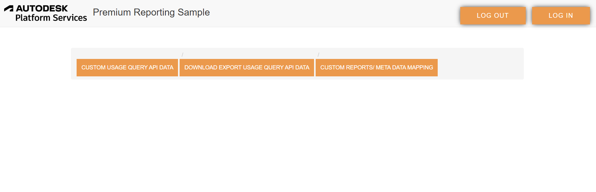

# Description

The sample helps viewing, building custom reports and exporting usage query & export usage query API data in the form of tables, charts from Business Success Plan Reporting Sample.

Uses 3-legged oAuth2 with PKCE to authenticate with aps.

### Pre-requisites

- Autodesk Platform Services Account: Learn how to create a aps Account, activate subscription and create an app at [this tutorial](https://forge-tutorials.autodesk.io/)

- Visual Studio Code

- Go Live Extension in Visual Studio Code.

- Tested to be working on: Chrome, IE Edge

- When logging into the web dashboard, you should login with the ID of an administrator with premium benefits (EBA).If you login with a user that does not have such roles, the API will return no data.

### Usage

- After logging in, pick an account from the **Account** dropdown. Every query and export is scoped to the account selected there, so an administrator who manages several accounts sees one at a time rather than all of them combined.

- Accounts that lack the `ReportingAPIAccess` reporting benefit are still listed, but greyed out - the API accepts queries for them and returns no data, so there is nothing to show.

- The tables fill in a page at a time as results arrive; the progress line under the buttons shows how many rows of the total have been rendered so far.

- Column widths can be dragged using the handle on the right-hand edge of each header cell.

### Loading history a week at a time

Querying an account's entire usage history is slow enough to time out on a large team, so **Load last week** fetches only the last 7 days. **Load prior week** then steps backwards, and each week is merged into the rows already on screen rather than appended:

- `totalUniqueDays` adds up - the weekly windows never overlap, so the count stays exact.
- the earliest and latest usage dates widen to cover everything loaded.
- one user and product stays one row, however many weeks you load.

The coverage note above the tables always states the range currently loaded. Read it, because two columns ask a 60-day question and cannot answer it from a single week:

- **Potential Flex Candidate** looks for fewer than 7 usage days. Inside one week the maximum is 7, so almost everybody qualifies until you have loaded more history.
- **Inactive Users (60 days)** needs about 9 weeks loaded. A user who has not touched a product recently produces no rows at all in a recent week, so they cannot show up as inactive until the window reaches back far enough to find their last usage.

Insights rate limits are counted per user across every application that user runs, so a `429` is treated as a statement about the whole client rather than about one request: a backoff window is recorded and **every** subsequent call waits for it to expire, not just the request that was rejected. The only calls that can still land inside the window are ones already in flight when the `429` arrived.

Be aware that a browser cannot read how long to wait. APS answers with `Access-Control-Expose-Headers: x-request-id`, and `Retry-After` is not on the CORS safelist, so `response.headers.get("Retry-After")` is `null` for these cross-origin calls even though the header is present on the wire. The sample still reads it - it costs nothing, and it works behind a same-origin proxy or if APS ever exposes the header - but in a plain browser deployment it falls back to waiting 5s, then 10s, 20s, 40s, and 60s per further attempt. If you need the server's real figure, proxy the API through your own origin and add `Retry-After` to the exposed headers.

Note that `POST /usage-queries` has no date parameter, so the window is applied through the `where` clause on `usageDate`. The documentation gives no date example, so the sample tries a few forms on its first query and reuses whichever the service accepts; if none are accepted it falls back to querying all history and says so.

### Setup

- Create a [Autodesk Platform Services app](https://forge-tutorials.autodesk.io/) with access to the Premium Reporting API.

- Take note of the Client ID which you need to enter as soon as you login. No client secret is needed with PKCE.

- Use http://localhost:5500 as redirect URL in aps App - with no trailing slash. APS compares callback URLs as exact strings, so http://localhost:5500/ is a different URL and will be rejected.

- Go Live opens 127.0.0.1 by default, which will not match. Either browse to http://localhost:5500 instead, or set `"liveServer.settings.host": "localhost"` in your VS Code settings so Go Live uses it automatically.

- Clone or download the folder. Open the folder inside in Visual Studio Code.

- Click Go live to run live server.

  

### Meta Data Mapping

- Save your metadata in the JSON format in the root folder.
- Here is the sample of metadata.
- Make changes as per your mapping in js/jsonToTable.js file.

### Deployment

The above sample is deployed on https://autodesk-platform-services.github.io/aps-business-success-plan-report/

To deploy your changed code use GitHub pages. Follow this [tutorial](https://www.youtube.com/watch?v=SKXkC4SqtRk)

Note- As soon as you deploy it the redirect URL becomes the deployment domain.

## Support

For support, please contact aps.help@autodesk.com.

## License

This sample is licensed under the terms of the [MIT License](https://tldrlegal.com/license/mit-license).
Please refer to [LICENSE](LICENSE) for more details.

## Written by

Deepali Srivastava, Autodesk Platform Services Partner Development Group
